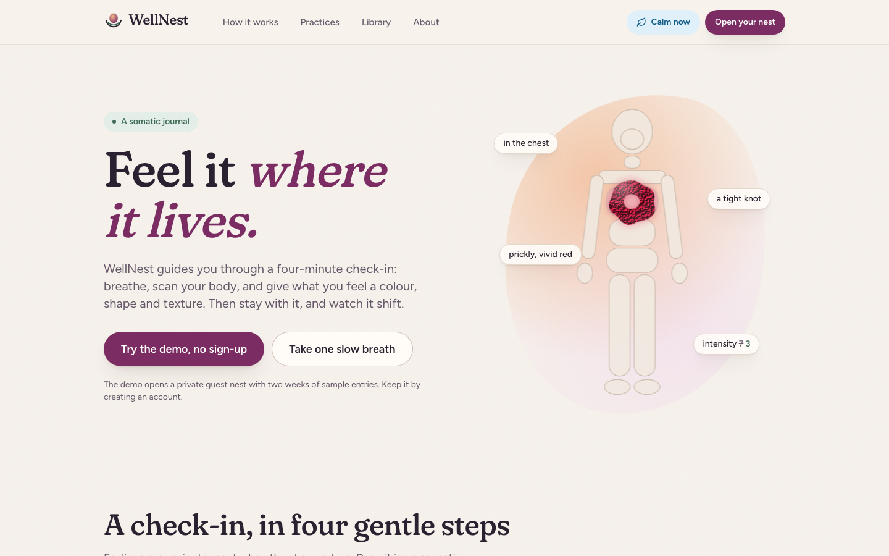
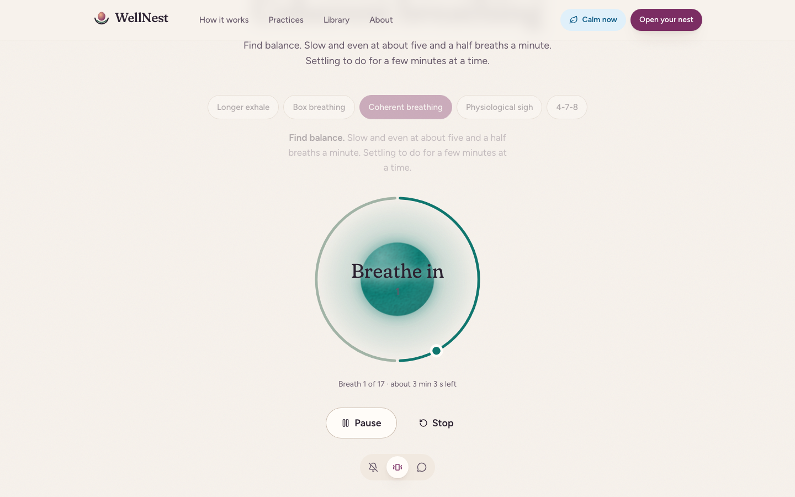
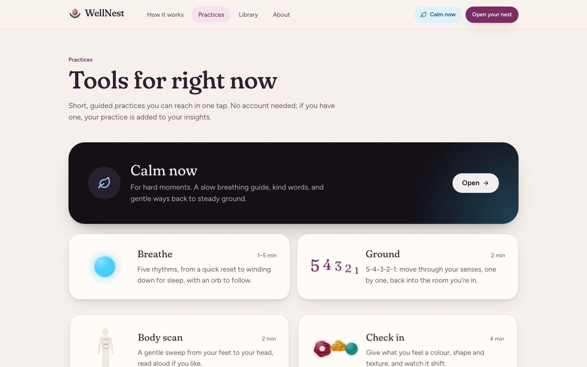
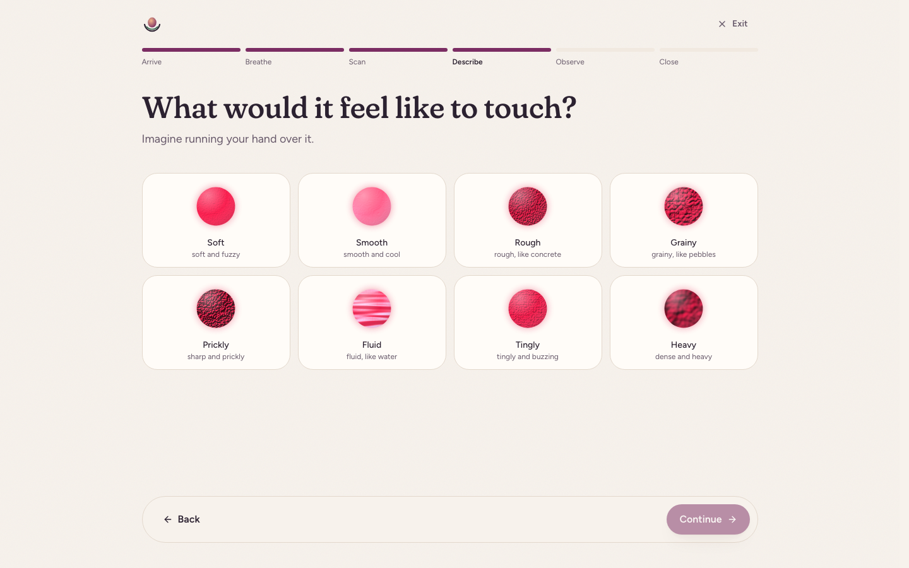
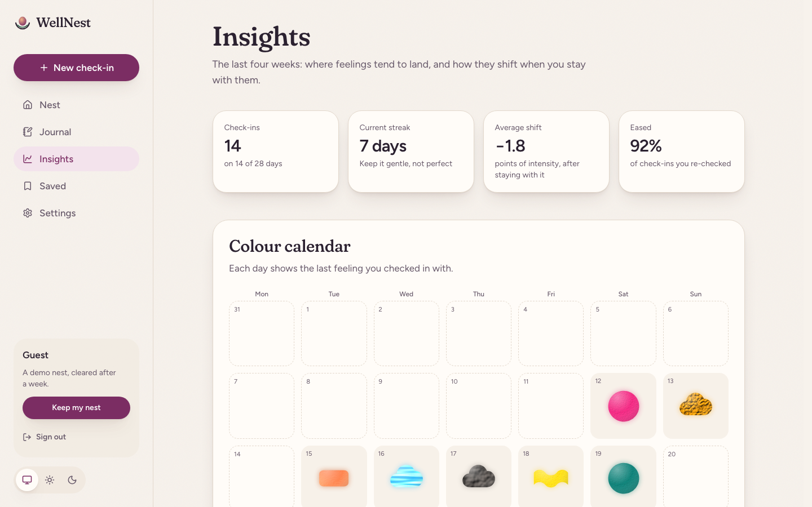
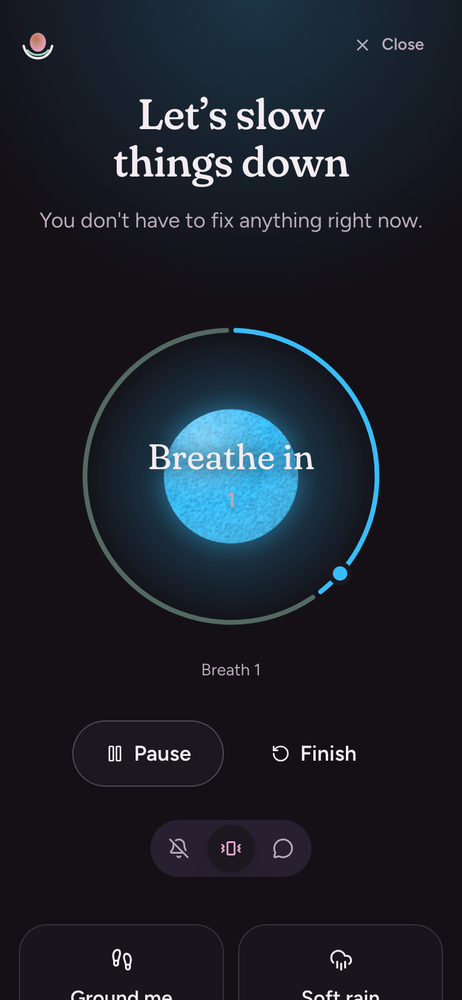
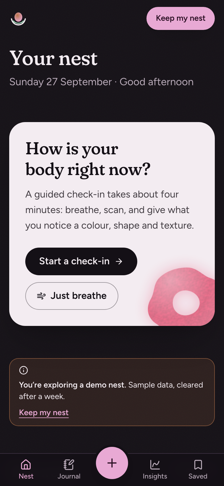

# WellNest

**Feel it where it lives.** A somatic check-in and journal: notice where a feeling sits in your body, give it a colour, shape and texture, stay with it for a minute, and watch it shift.

<!-- After deploying, add: **[Live demo](https://your-app.vercel.app)** · [Case study](https://your-app.vercel.app/about) -->

No sign-up needed to try it: the demo opens a guest nest with two weeks of sample data.



<table>
  <tr>
    <td></td>
    <td></td>
  </tr>
  <tr>
    <td></td>
    <td></td>
  </tr>
  <tr>
    <td align="center"></td>
    <td align="center"></td>
  </tr>
</table>

## What it does

- **A guided somatic check-in** (about four minutes): name how you feel → breathe → a guided body scan → pick where the feeling is on a body map → give it a colour, shape (or draw one), texture and intensity → stay with it for a minute → check again and record what shifted. It ends with up to three gentle suggestions for what might help next, chosen from what you described.
- **Felt-sense portraits.** Every check-in becomes a small generative artwork. Textures are SVG filter recipes (turbulence + lighting), so they adapt to any colour and cost zero image bytes.
- **A calm toolkit, no account needed:**
  - five breathing rhythms (longer exhale, box, coherent, physiological sigh, 4-7-8), each with a luminous orb that swells and settles with your breath;
  - optional bell, vibration and spoken cues, and the screen stays awake during a session;
  - 5-4-3-2-1 grounding and a voice-guided body scan;
  - **Calm now**, a night-sky space for hard moments.
- **Soundscapes** (rain, ocean, wind, brown noise), synthesised live with the Web Audio API: no audio files, never quite the same twice. They keep playing as you move around the app, and a sleep timer fades them out.
- **A journal** linked to check-ins, with writing prompts and Postgres full-text search (ranked, with highlighted matches).
- **Insights**: streaks, average shift, minutes practised and how often you felt calmer afterwards, a colour calendar, a before/after chart, a body heat map and the feelings you name most.
- **A daily reminder** you add to your own calendar (`.ics`, floating local time), so there's no notification infrastructure.
- **Private by design**: no trackers or analytics, JSON export and one-step account deletion. Guest nests are removed after a week.

## Lighthouse

Measured locally against a production build (`next build && next start`) with Lighthouse 13, including signed-in pages:

|                     | Performance | Accessibility | Best practices |   SEO   |
| ------------------- | :---------: | :-----------: | :------------: | :-----: |
| Desktop, every page |   **100**   |    **100**    |    **100**     | **100** |
| Mobile, every page  |    95–98    |    **100**    |    **100**     | **100** |

Mobile performance is simulated on a throttled slow-4G connection with a 4× slower CPU. At that setting the React/Next.js runtime alone decides the last few points: an untouched `create-next-app` page scores 98 in the same setup. Everything the app controls is tuned. It has zero layout shift, ~10 ms of blocking time, self-hosted fonts subset to the glyphs used, no render-blocking requests, and off-screen sections skipped with `content-visibility`. CI enforces the budget (see [`lighthouserc.json`](lighthouserc.json)).

## Stack

**Next.js 16** (App Router, React Server Components, Server Actions, Cache Components / Partial Prerendering, React Compiler, typed routes) · **React 19.2** · **TypeScript** (strict) · **Tailwind CSS 4** · **Postgres** with **Drizzle ORM** · **Better Auth** · **Zod** · **MDX** · **Vitest** + Testing Library · **Playwright** + **axe-core** · Vercel (Fluid compute, Cron)

## Architecture notes

**Rendering.** Every route prerenders a static HTML shell at build time. Anything personal (the session, a user's check-ins) streams into it behind `<Suspense>` boundaries. The largest element on each page is part of the static shell, so first paint never waits on the database. The build output shows every page as either static or partially prerendered.

**Data Access Layer.** All reads and writes go through `src/lib/data/*`. Each function resolves the signed-in user itself and scopes every query by that user id, so no caller can ask for someone else's rows. The original app let any signed-in user edit or delete anyone's entries; this closes that class of bug by construction.

**The check-in as a state machine.** [`check-in-machine.ts`](src/lib/somatic/check-in-machine.ts) is a pure reducer with typed actions and guards: you can't advance without an answer, and the "nothing shifted" path skips a step. It's unit-tested, persisted to `sessionStorage` so a refresh resumes where you were, and converted to a payload the server validates again with Zod.

**Search.** `journal_entry.search` is a generated `tsvector` column (title weighted above body) with a GIN index, queried with `websearch_to_tsquery` so people can type naturally (quotes, `or`, `-exclude`). `ts_headline` marks matches with private-use Unicode characters rather than HTML, and React turns them into `<mark>` elements, so user text is never rendered as markup.

**Guests who become users.** "Try the demo" signs you in anonymously and seeds two weeks of believable data. If the guest then signs up, the anonymous account is linked in place and everything moves across in one transaction. A daily Vercel Cron removes guest nests older than a week.

**Motion that respects you.**

- Page changes use React's `<ViewTransition>` (the browser View Transitions API): content fades and rises while the layout stays anchored, and skeletons hand off to real content.
- Scroll reveals are CSS scroll-driven animations (`animation-timeline: view()`), transform-only so text contrast is never reduced.
- The breathing orb is driven by a pure breathing engine ([`breathing.ts`](src/lib/somatic/breathing.ts), unit-tested) and written to the DOM each frame, so React re-renders only when the phase changes.
- Everything honours `prefers-reduced-motion` and an in-app Motion setting, applied before first paint.

**Sound without files.** Soundscapes are shaped noise: pink, brown and white noise with seamless crossfaded loops, filters, and slow LFOs for waves and gusts, plus sparse decaying clicks for raindrops. Cues are detuned sine "bells", and voice guidance uses the browser's speech synthesis, preferring a British English voice. The synthesis code loads only on first play, and the player lives in the root layout so audio survives navigation.

**Accessibility.** The app uses native controls throughout: radio groups for every picker, a native `<dialog>` for confirmations, and ARIA tabs with roving focus. Focus moves to each new check-in question, and live regions announce breathing phases and timers. It respects `prefers-reduced-motion`. Charts have legends, keyboard-reachable marks and table views, and their colours are validated for colour-blind separation and contrast in both themes. Playwright runs axe (WCAG 2.2 AA + best practices) on every page, desktop and mobile.

**Performance details.**

- The fonts are subset and instanced with fontTools ([`scripts/subset-fonts.py`](scripts/subset-fonts.py)): 46 KB for both families instead of 81 KB.
- The body font uses `font-display: optional`, so text never re-renders after first paint.
- Animations are transform-only, so they run on the compositor.
- Below-the-fold sections use `content-visibility: auto`.
- The whole app ships 8.5 KB of its own client JavaScript on top of the framework.

## Project structure

```
src/
  app/
    (site)/        public pages: landing, practices, breathe, grounding, body scan, library, about
    (calm)/        Calm now, always in a night palette
    (auth)/        sign in, sign up, and the auth Server Actions
    (focus)/       the distraction-free check-in
    (app)/         signed-in app: nest, journal, insights, saved, settings
    api/           Better Auth handler, JSON export, cleanup cron
  components/      UI primitives, somatic components (orb, body map, pickers, breathing), charts
  content/library  MDX articles and their metadata
  lib/
    somatic/       domain model: regions, shapes, textures, colours, state machine, breathing, insights
    audio/         Web Audio synthesis: soundscapes, cues, speech
    data/          Data Access Layer (every query scoped to the session user)
    db/            Drizzle schema and client
e2e/               Playwright specs (desktop + mobile, axe on every page)
drizzle/           SQL migrations
```

## Running it locally

Requirements: Node 22.12+, pnpm 10, and Postgres 14+ (Docker is easiest).

```bash
pnpm install
docker compose up -d              # Postgres on localhost:5432
cp .env.example .env.local        # then set BETTER_AUTH_SECRET: openssl rand -base64 32
pnpm db:migrate
pnpm dev                          # http://localhost:3000
```

| Command                                | What it does                                                                                  |
| -------------------------------------- | --------------------------------------------------------------------------------------------- |
| `pnpm dev`                             | Development server (Turbopack)                                                                |
| `pnpm build && pnpm start`             | Production build and server                                                                   |
| `pnpm check`                           | Lint, type-check and unit tests                                                               |
| `pnpm test:e2e`                        | Playwright end-to-end + accessibility suite (set `E2E_DATABASE_URL` to a disposable database) |
| `pnpm db:generate` / `pnpm db:migrate` | Create / apply Drizzle migrations                                                             |
| `pnpm db:studio`                       | Browse the database                                                                           |

## Deploying to Vercel

1. Import the repository in Vercel. The framework preset and build settings are detected automatically.
2. Add a Postgres database from **Storage → Marketplace → Neon**. `DATABASE_URL` is set for you.
3. Add environment variables: `BETTER_AUTH_SECRET` (`openssl rand -base64 32`) and `CRON_SECRET` (any long random string). Optionally add `GITHUB_CLIENT_ID` / `GITHUB_CLIENT_SECRET` to enable "Continue with GitHub".
4. Deploy. The `vercel-build` script applies migrations before building, so a fresh database works on the first deploy. The site URL is detected from Vercel's environment; set `BETTER_AUTH_URL` only if you use a custom domain.

### Using Supabase instead of Neon

Supabase works as plain Postgres; the app doesn't use its client libraries. Set the variables yourself rather than through the Vercel integration, which names them differently.

- `DATABASE_URL`: the **transaction pooler** string (port 6543) from **Connect**. Vercel can't reach the IPv6-only direct connection.
- `DATABASE_URL_UNPOOLED`: the **session pooler** string (port 5432), used for migrations.
- `DATABASE_CA_CERT`: the contents of the certificate from **Database Settings → SSL Configuration**, so TLS is verified. Don't add `sslmode` to the URLs; it would override this.
- Turn off the **Data API**. The app never uses it, and it would otherwise expose tables such as `session` over REST.

## Testing

- **Unit** (Vitest, 42 tests): the check-in state machine, the breathing engine, suggestions, insights maths, colour naming, validation schemas, and keyboard behaviour of the tabs component.
- **End-to-end** (Playwright, desktop Chrome + Pixel 7, 69 tests):
  - the full check-in, from breathing to a linked journal entry;
  - journal search, edit and delete;
  - sign-up, sign-in, redirect-back and server-side validation;
  - a guest keeping their data after signing up;
  - grounding from start to finish, a soundscape surviving navigation and its sleep timer, Calm now's night palette, the calendar reminder, the motion setting and post-check-in suggestions.
- **Accessibility**: axe runs on every public and signed-in page, and after interactive states.
- **CI** (GitHub Actions): formatting, lint, types and unit tests; then e2e against a Postgres service; then Lighthouse CI with enforced scores.

## History and credits

WellNest began in August 2023 as a three-week final group project, a MERN app built by Elif Bensu Zorlu, [Phoebe St Leger-Davey](https://github.com/PStleger), [Keerthana Prabhakar](https://github.com/Keerthana-Prabhakar), Gisella Haladin and [Armi Mujica](https://github.com/armimujica). The original code lives on the other branches of this repository. This version is a from-scratch rebuild that keeps the idea at its heart: give a feeling a colour, shape and texture, and watch it change.

Fonts: [Fraunces](https://github.com/undercasetype/Fraunces) and [Figtree](https://github.com/erikdkennedy/figtree), both under the SIL Open Font License. Library articles cite their sources inline.

> WellNest is not a medical device, therapy or a crisis service. If you're in danger or thinking about ending your life, contact your local emergency number or find a helpline at [findahelpline.com](https://findahelpline.com).
